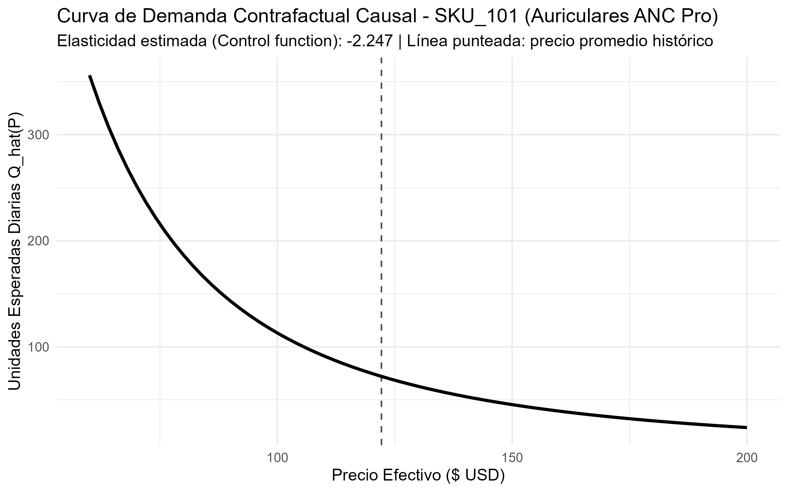
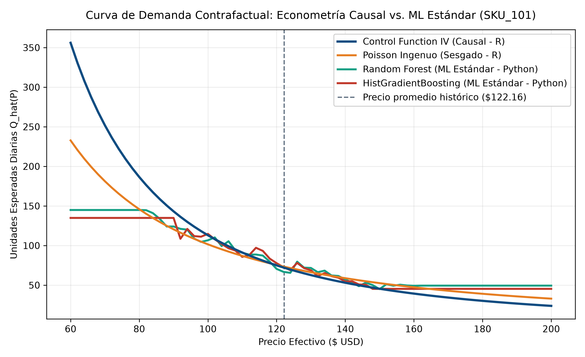
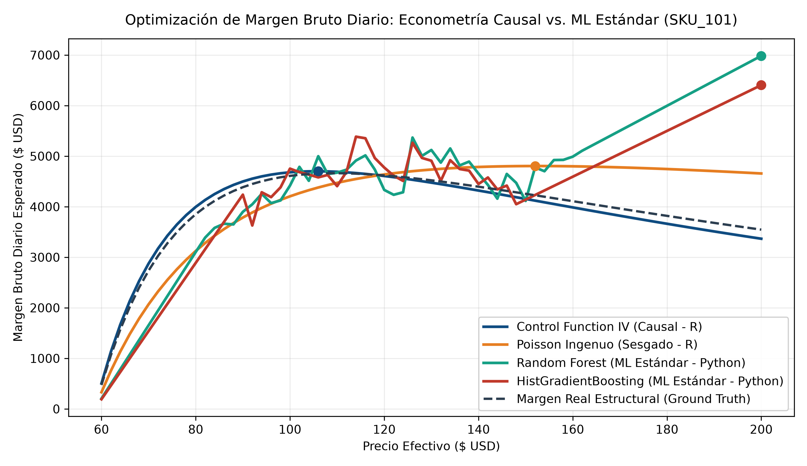

# Dynamic Price Optimization: Causal Econometrics (R) vs. Predictive Machine Learning (Python)

## Overview
This repository contrasts **causal econometrics** (estimated in **R**) against **standard predictive Machine Learning models** (trained in **Python**) in an e-commerce dynamic pricing and demand elasticity setting. The core objective is to demonstrate why strong predictive accuracy on historical data does not guarantee reliable counterfactual pricing decisions when prices are endogenous—and how optimizing directly over standard ML curves can destroy gross margin.

---

## Data Generating Process (DGP) & Price Endogeneity
In `01_dgp_ecommerce.R`, a daily panel dataset spanning **2 years (730 days)** across **3 SKUs** is simulated using a fixed seed (`1897`) and exported to `data/ecommerce_panel.csv`, including commercial and unit-economics variables such as `marginal_cost` and `discount_pct`.

Price endogeneity arises because commercial pricing rules react positively to unobserved demand shocks (`demand_shock`). Meanwhile, supplier freight cost shocks (`supplier_freight_index`) serve as an exogenous **instrumental variable (IV)** to isolate supply-driven price variation unrelated to contemporaneous demand shocks.

---

## Causal Identification in R (`02_causal_elasticity_r.R`)
Focusing on `SKU_101` (true structural price elasticity of **`-2.15`**):
* **Naive Poisson Regression:** Estimates a price elasticity of **`-1.624`**, biased upward (closer to zero) due to positive correlation between price and unobserved demand shocks.
* **Control Function Poisson with Instrumental Variable (`supplier_freight_index`):** Incorporates first-stage residuals to control for unobserved demand shocks and recovers a causal elasticity of **`-2.247`**, with a 95% Bootstrap confidence interval of **`[-2.4038, -2.1116]`** (covering the `-2.15` ground-truth parameter).

---

## Predictive Modeling in Python (`03_ml_demand_python.ipynb`)
In Python, `RandomForestRegressor` and `HistGradientBoostingRegressor` were trained on observable features (`effective_price`, `competitor_price`, `is_weekend`, `is_peak_event`, and `discount_pct`) without instrumental variable identification. Predictive performance (`RMSE` and `MAE`) was evaluated on `X_test`, and demand predictions were projected across a counterfactual price grid ranging from `$60` to `$200` USD.

### Key Limitation of Standard Predictive ML
Strong `RMSE` or `MAE` scores on `X_test` **only measure predictive accuracy on observed data generated under the same historical dynamics**; they do not ensure that the counterfactual price-response curve isolates the clean causal price effect achieved by the R instrumental variables model. Furthermore, because tree-based models do not extrapolate beyond the support of historical pricing rules, their demand curves flatten out at the lower and upper tails of the price grid.

---

## Gross Margin Optimization & Optimal Price ($P^*$)
Evaluating expected daily gross margin $\mathbb{E}[\Pi(P)] = (P - c) \cdot \hat{Q}(P)$ using the average marginal cost of **`$58.58` USD** for `SKU_101`:

| Model | Suggested Optimal Price ($P^*$) | Model Expected Margin ($/day) | Actual Market Margin ($/day) |
| :--- | :---: | :---: | :---: |
| **Control Function IV (Causal - R)** | `$106` | `$4,700.63` | `$4,656.07` |
| **Naive Poisson (Biased - R)** | `$152` | `$4,804.42` | `$4,226.19` |
| **Random Forest (Standard ML - Python)** | `$200` | `$6,983.24` | `$3,546.27` |
| **HistGradientBoosting (Standard ML - Python)** | `$200` | `$6,404.54` | `$3,546.27` |
| **True Structural Optimum (Ground Truth)** | `$110` | `$4,662.35` | `$4,662.35` |

* **Causal Robustness:** The R Control Function model recommends **`$106` USD**, closely matching the structural optimum (`$110` USD) and capturing **99.87%** of the maximum achievable daily gross margin (`$4,656.07` vs. `$4,662.35` USD/day).
* **Cost of Endogeneity Bias:** The naive Poisson model underestimates price sensitivity and pushes $P^*$ up to **`$152` USD**, eroding **`$429.88` USD/day** (~`$156.9k` USD/year on a single SKU) in actual market margin.
* **Tree-Based Extrapolation Risk:** Because `Random Forest` and `HistGradientBoosting` flatten out above `$160` USD, multiplying $(P - c)$ by a constant predicted quantity causes expected margin to grow artificially toward the upper bound (**`$200` USD**), destroying over **`$1,100` USD/day** (`-$405k` USD/year) relative to the causal policy.

---

## Repository Structure
* `01_dgp_ecommerce.R`: Simulates the 730-day multi-SKU panel dataset with price endogeneity and exports `data/ecommerce_panel.csv`.
* `02_causal_elasticity_r.R`: Estimates Naive Poisson vs. Control Function IV models, runs Bootstrap inference, and generates the causal counterfactual demand curve.
* `03_ml_demand_python.ipynb`: Trains standard ML models in Python, compares counterfactual demand curves against R outputs, and performs gross margin optimization.
* `data/`: Generated panel dataset (`ecommerce_panel.csv`).
* `outputs/`: Exported counterfactual curves and gross margin optimization visualizations.